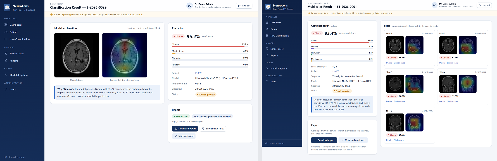
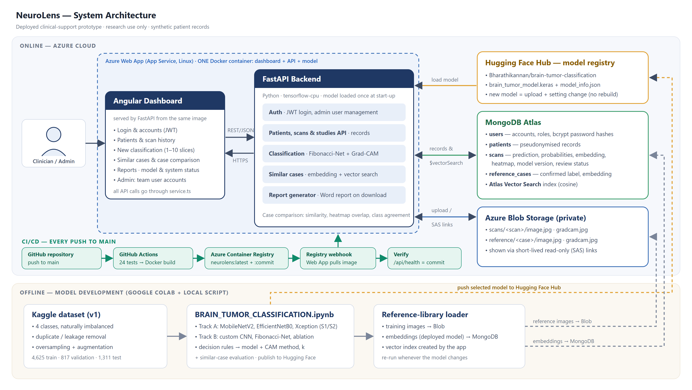

## SECTION 1 : PROJECT TITLE — NeuroLens: Explainable, Case-Grounded Brain Tumour MRI Classification

**An explainable clinical-support prototype for brain MRI.** NeuroLens classifies an MRI slice into glioma, meningioma, pituitary tumour or no tumour, shows **where the model looked** (Grad-CAM heatmap), finds the **most similar confirmed cases** (vector search), compares cases side by side, combines several slices of one scan into one result, and produces a Word **report** — all from one dashboard with patient records and user accounts.

- **Live site:** https://neurolens-xai.azurewebsites.net
- **Stack:** TensorFlow / Keras · FastAPI (Python) · Angular · MongoDB Atlas (Vector Search) · Azure Blob Storage · one Docker container on an Azure Web App



> Research prototype for the NUS-ISS Pattern Recognition Systems Practice Module — **not a diagnostic device**. All patient records are synthetic.

---

## SECTION 2 : EXECUTIVE SUMMARY / PAPER ABSTRACT

Brain tumours are classified from MRI by specialists, and the type matters: gliomas are usually malignant, meningiomas mostly benign, and pituitary tumours sit at the base of the skull. Convolutional neural networks reach high accuracy on public datasets, but three gaps limit their use as a support tool: many strong models are large and slow on ordinary hardware; heatmaps are shown without checking that they are faithful to the model; and predictions are rarely linked back to similar confirmed cases, which is how radiologists themselves reason.

NeuroLens closes these gaps, and **every component was chosen by a measured comparison with a decision rule fixed in advance**:

- **Classifier.** Five architectures in two tracks were trained on the same cleaned split: three fine-tuned ImageNet models (MobileNetV2, EfficientNetB0, Xception) and two networks trained from scratch (a KerasTuner-tuned custom CNN and Fibonacci-Net, a lightweight 2025 architecture). **Fibonacci-Net** won: **97.2% test accuracy, macro-F1 0.971, glioma recall 96.3%**, while being about 7× smaller than MobileNetV2 (0.38 M parameters) and classifying an image in about 92 ms on a CPU.
- **Explanation.** Five CAM methods were compared with deletion/insertion tests, a weight-randomisation sanity check and a CPU time limit. Only Grad-CAM and Eigen-CAM passed the sanity check; **Grad-CAM** had the better faithfulness score and is used in the application.
- **Similar-case search.** The classifier's own 377-value embedding finds same-class cases far better than generic features (precision@5 **0.972** vs 0.862 for ImageNet features and 0.799 for raw pixels). Agreement among the 10 nearest cases is a useful warning: when nearly all agree the classifier is right 98.2% of the time; when half or fewer agree, only 27.3%.
- **Multi-slice studies** reuse the same 2D model on 2–10 slices of one scan, average the probabilities, and flag the study if any slice disagrees or the average confidence is below 70%.

The application runs as one Docker container on Azure; every push to `main` is tested, built, deployed and verified automatically, and a new model only needs an upload to Hugging Face.

---

## SECTION 3 : CREDITS / PROJECT CONTRIBUTION

| Official Full Name | Student ID (MTech Applicable) | Work Items (Who Did What) | Email (Optional) |
| :------------ |:---------------:| :-----| :-----|
| Ilanchezhiyan Bharathikannan | A0134740M | 1. Defined the problem, objectives and scope, and wrote the project proposal and both presentations<br>2. Built the data pipeline: downloaded the Kaggle dataset, found and removed 134 training images that leaked into the test set and 191 duplicates using MD5 hashes, made a stratified train/validation split and balanced the classes with augmentation-based oversampling on the training split only<br>3. Designed a fair two-track model comparison with a decision rule fixed before training: highest macro-F1, ties within one point broken by size and speed<br>4. Fine-tuned MobileNetV2, EfficientNetB0 and Xception in two stages (new head only, then the top 20 layers) and compared both stages for each model<br>5. Trained a custom CNN with KerasTuner hyperparameter search, which lifted its macro-F1 from 0.725 to 0.914<br>6. Reimplemented Fibonacci-Net (Roy et al. 2025) from the paper, tuned its learning rate, and ran an ablation study on its Avg-2Max pooling<br>7. Selected Fibonacci-Net (97.2% accuracy, macro-F1 0.971, glioma recall 96.3%, 0.38 M parameters) and published it with its metadata to the Hugging Face model registry<br>8. Compared five CAM methods (Grad-CAM, Grad-CAM++, Score-CAM, Layer-CAM, Eigen-CAM) with deletion/insertion tests, a weight-randomisation sanity check and CPU timing, and chose Grad-CAM<br>9. Built and evaluated similar-case search on the model's own embeddings (precision@5 0.972), chose k = 10 by how well case agreement flags wrong predictions, and showed that agreement is a reliable warning (98.2% vs 27.3% accuracy)<br>10. Designed multi-slice studies that combine 2–10 slices of one scan without retraining, with a flag when slices disagree<br>11. Built the FastAPI backend: classification with Grad-CAM, embeddings and MongoDB Atlas Vector Search with an exact-search fallback, case comparison (similarity, heatmap overlap, class agreement), patient records, studies, template-based explanations and Word reports<br>12. Built the Angular dashboard: dashboard, patients, new classification, result, multi-slice result, similar cases, comparison, reports, model & system, and user administration pages<br>13. Implemented security: JWT sign-in, password hashing, administrator and clinician roles, pseudonymised patient records and private image storage with short-lived links<br>14. Packaged the dashboard, API and model into one Docker image and built the CI/CD pipeline: GitHub Actions runs the tests, builds the image, pushes it to Azure Container Registry, deploys it to an Azure Web App and verifies the live version<br>15. Found and fixed a defect where computing heatmaps silently changed the model's BatchNorm statistics, making predictions drift between requests, and added a regression test<br>16. Wrote 26 automated tests, the developer guide, the final report, the individual report and the video presentation | |

---

## SECTION 4 : VIDEO OF SYSTEM MODELLING & USE CASE DEMO

<a href="https://youtu.be/24CRg9Hdhk8" title="NeuroLens video presentation"></a>

A 12-minute presentation in two parts. **Part A** demonstrates the live application through three clinical use cases: classifying several slices of one scan, classifying and explaining a single slice (including the model's one mistake on the test images, which is flagged as low confidence), and checking a prediction against similar confirmed cases. **Part B** explains how it works, following the architecture above: the data and preprocessing, the model comparison and selection, the ablation study, the choice of heatmap method, the evaluation of similar-case search, multi-slice studies, the engineering and deployment, and the limitations.

---

## SECTION 5 : USER GUIDE

Installation and user guide for the live system and for running NeuroLens on your own machine.

### [ 1 ] Use the live system (nothing to install)

> Open https://neurolens-xai.azurewebsites.net in a web browser

| | |
|---|---|
| **Administrator email** | `admin@neurolens.com` |
| **Administrator password** | `Neurolens@2026` |
| API documentation | https://neurolens-xai.azurewebsites.net/docs |
| Health check | https://neurolens-xai.azurewebsites.net/api/health — shows `"model":"ready"` when the app is ready |

> The first request after the site has been idle can take a minute while the container starts and the model loads.

Download or clone this repository to get the test images in [`test_data/`](test_data):

| Folder | Contents | Use it for |
|---|---|---|
| [`test_data/single_slice/`](test_data/single_slice) | 10 held-out test slices for each of the 4 classes (`glioma`, `meningioma`, `notumor`, `pituitary`) | a normal classification |
| [`test_data/multi_slice/`](test_data/multi_slice) | real slices of the same patient, one folder per patient (4–5 slices each) | the multi-slice upload |

1. **Log in** with the administrator account above.
2. **Patients → Add patient** (pseudonymised: age, sex, referring unit).
3. **Multi-slice:** **New Classification** → choose the patient and select **all** images in one patient folder, for example `test_data/multi_slice/glioma/patient_MR054683` → one combined result, each slice with its own heatmap, flagged for review if the slices disagree.
4. **One slice:** upload `test_data/single_slice/glioma/Te-gl_0019.jpg` → prediction, class probabilities, Grad-CAM heatmap and explanation. Then upload `Te-gl_0239.jpg` → the model's one mistake on the test images, flagged as low confidence.
5. **Mark reviewed** on the result page — reviewed scans become confirmed cases for similar-case search.
6. **Find similar cases** → **Compare** with one of them: similarity, heatmap overlap, class agreement and the reasons.
7. **Download report** (Word) from a result page or from **Reports**. **Model & System** shows the deployed model, service status and the model comparison; **Users** lets the administrator add team members.

Scans are labelled **Single slice** or **Multi-slice** everywhere they appear, and in the Word reports.

### [ 2 ] Run the system on your own machine

You need **Python 3.10–3.12**, **Node.js 20+** and a MongoDB database (MongoDB Atlas or a local MongoDB).

> $ git clone https://github.com/ibharathikannan/neuro-lens-xai.git

> $ cd neuro-lens-xai/backend

> $ py -3.12 -m venv .venv          (macOS/Linux: python3.12 -m venv .venv)

> $ .venv\Scripts\activate          (macOS/Linux: source .venv/bin/activate)

> $ pip install -r requirements-dev.txt

> $ copy .env.example .env          (macOS/Linux: cp .env.example .env) — then set MONGODB_URI, JWT_SECRET_KEY and FIRST_ADMIN_EMAIL / FIRST_ADMIN_PASSWORD

> $ python app.py                   (API on http://localhost:8000; the model downloads from Hugging Face on first start)

In a second terminal:

> $ cd neuro-lens-xai/frontend

> $ npm install

> $ npm start

> **Go to URL using web browser** http://localhost:4200 and sign in with the administrator account from `.env`.

Run the tests with `pytest -q` in `backend/` (26 tests; no database or internet needed). Full instructions, the project structure and the API reference are in [`docs/DEVELOPER_GUIDE.md`](docs/DEVELOPER_GUIDE.md).

### [ 3 ] Deployment

```
GitHub (push to main)
   └─ GitHub Actions: tests → Docker build → Azure Container Registry → Azure Web App → check the live version
Azure Web App (one Docker container)
   ├─ Angular dashboard
   └─ FastAPI backend ── loads the model from Hugging Face at start-up
         ├─ MongoDB Atlas      patients, scans, users, embeddings + Atlas Vector Search
         └─ Azure Blob Storage  scan images and heatmaps (private, short-lived links)
```

- **Model updates** need no code change: upload the new model to Hugging Face, change the Web App setting `HF_REPO_ID` / `HF_MODEL_FILENAME`, and restart.
- **Settings and secrets** (database, storage, login keys) are Web App configuration — never stored in this repository.

---

## SECTION 6 : PROJECT REPORT / PAPER

### 6.1 Business problem background

Reading brain MRI takes time and specialist expertise, and readers do not always agree. AI models can help, but most are a black box: they give a label without a reason a doctor can check. Large models are also costly to run, heatmaps are rarely tested for faithfulness, and predictions are seldom linked to comparable past cases.

### 6.2 Project objectives & success measurements

| Objective | How NeuroLens meets it | How it is measured |
| --- | --- | --- |
| Choose the classifier with evidence | Two-track comparison of five architectures with a fixed rule | Test macro-F1, glioma recall, parameters and CPU latency |
| Explanations that are tested, not assumed | Five CAM methods compared; Grad-CAM deployed | Deletion/insertion areas, weight-randomisation sanity check, CPU time |
| Case-based evidence for every prediction | Similar confirmed cases from the model's own embedding | Precision@k, kNN accuracy, error-detection AUROC, agreement bands |
| A usable, deployed clinical-support tool | Dashboard with patients, studies, comparison, reports and accounts | Use-case demonstrations, automated tests and continuous deployment |

### 6.3 Data and preprocessing

- **Dataset:** Kaggle Brain Tumor MRI Dataset v1 (Nickparvar) — 7,023 slices in 4 classes, built from the Figshare, SARTAJ and Br35H collections. The published Testing folder (1,311 images) is the test set.
- **Cleaning:** MD5 hashing found **134 training images that were also in the test set** and 191 duplicates inside Training; both were removed (5,712 → 5,442 training images).
- **Split:** 4,625 training · 817 validation · 1,311 test images, stratified by class.
- **Imbalance:** minority classes oversampled to 1,224 images each on the training split only, with random augmentation (rotation, shift, zoom, flip, brightness). Images are converted to RGB, resized to 224 × 224 and scaled to [0, 1] — the same steps the backend uses.

### 6.4 Project solution

**Architecture.** An offline part (Google Colab: data, training, comparison, publishing) and an online part (one Docker container on Azure with the Angular dashboard and the FastAPI backend), linked only by the Hugging Face model registry and the library of confirmed cases. See the diagram in Section 4.

**Classifier — Fibonacci-Net.** Fibonacci-scaled filter counts, depth-wise separable convolutions and Avg-2Max pooling in parallel skip connections; 381,286 parameters (4.8 MB). The input of its final dense layer is the 377-value embedding used for similar-case search, so retrieval needs no extra model.

**Explanation — Grad-CAM** on the last depth-wise separable block, with a template-based explanation sentence filled from measured values (so the text never invents findings).

**Similar cases.** Unit-length embeddings compared by cosine similarity in MongoDB Atlas Vector Search (exact search as a fallback) over a reference library from the training split plus all reviewed scans. The dashboard shows the 10 closest confirmed cases and how many agree with the prediction; any case can be compared side by side (similarity, heatmap overlap, focus region, class agreement).

**Multi-slice studies.** Each slice is classified and explained on its own; probabilities are averaged; the study is flagged if any slice disagrees or the average confidence is below 70%.

**Security and privacy.** JWT sign-in, hashed passwords, administrator and clinician roles, self-registration off, pseudonymised patients, private Blob Storage reached only through short-lived read-only links.

### 6.5 Project implementation

- **Research:** one Colab notebook ([`research/BRAIN_TUMOR_CLASSIFICATION.ipynb`](research/BRAIN_TUMOR_CLASSIFICATION.ipynb)) with result tables exported to `research/`.
- **Application:** FastAPI routers for authentication, patients, scans, studies, similar cases, reports and the dashboard; Angular pages for every workflow.
- **Testing:** 26 automated tests with an in-memory database and a stand-in model (accounts, roles, patients, classification, similar cases, multi-slice studies, scan-type labels, reports), plus a Grad-CAM regression test with TensorFlow.
- **Deployment:** GitHub Actions → Docker → Azure Container Registry → Azure Web App, with a check that `/api/health` reports the new version.

### 6.6 Project performance & validation

**Classification** (1,311 test images, best configuration per model):

| Model | Track | Accuracy | Macro-F1 | Glioma recall | Parameters | CPU latency |
| --- | --- | --- | --- | --- | --- | --- |
| **Fibonacci-Net (lr 1e-3)** | From scratch | **0.972** | **0.971** | **0.963** | **0.38 M** | **92 ms** |
| MobileNetV2 (S2) | Fine-tuned | 0.946 | 0.943 | 0.907 | 2.59 M | 230 ms |
| Xception (S2) | Fine-tuned | 0.944 | 0.941 | 0.897 | 21.39 M | 397 ms |
| EfficientNetB0 (S2) | Fine-tuned | 0.938 | 0.935 | 0.897 | 4.38 M | 391 ms |
| Custom CNN (tuned) | From scratch | 0.916 | 0.914 | 0.850 | 9.67 M | 73 ms |

**Ablation:** Fibonacci-Net without Avg-2Max pooling scored macro-F1 0.981 in a single run, so in this setup the layer added no measurable value; the deployed model was not changed after seeing the test result.

**Heatmap methods** (100 correctly classified test images):

| Method | Deletion ↓ | Insertion ↑ | Sanity correlation (pass < 0.5) | CPU time | Verdict |
| --- | --- | --- | --- | --- | --- |
| Score-CAM | 0.454 | 0.778 | 0.723 | 9.2 s | Fails sanity, too slow |
| Layer-CAM | 0.470 | 0.779 | 0.649 | 0.26 s | Fails sanity |
| Grad-CAM++ | 0.470 | 0.779 | 0.649 | 0.27 s | Fails sanity |
| **Grad-CAM** | **0.481** | **0.780** | **0.157** | **0.27 s** | **Passes — chosen** |
| Eigen-CAM | 0.628 | 0.605 | −0.165 | 0.29 s | Passes, weak deletion |

**Similar-case search:** precision@5 0.972 with the model's embedding vs 0.862 (ImageNet features) and 0.799 (raw pixels); kNN accuracy 0.973; k = 10 gives the best error-detection AUROC (0.838); same-class vs different-class separation AUROC 0.986. Classifier accuracy is 98.2% when nearly all 10 cases agree and 27.3% when half or fewer agree.

**Application checks:** 39 of 40 held-out single slices correct, and the one error is flagged as low confidence; all 15 demonstration studies (71 slices) correct.

### 6.7 Project conclusions: findings & recommendations

- **A small from-scratch network beat large pretrained models** on this task, and is also the cheapest to run on a CPU.
- **Popular heatmap methods can fail a sanity check.** Three of five produced maps that barely changed when the model's weights were randomised; heatmaps are also least informative for glioma.
- **Case agreement is a useful warning signal** that concentrates the classifier's errors.
- **Inference must never change the model:** a defect that let heatmap computation update BatchNorm statistics was found and fixed, with a regression test.
- **Limitations:** one public dataset of 2D slices without external validation; near-duplicate slices may make test scores optimistic; single training runs; multi-slice averaging is not a 3D model.
- **Recommendations:** a patient-level split and an external test set, repeated runs with confidence intervals, a stronger faithfulness test, full 3D scans, and feedback from radiologists.

### 6.8 Mapping of system functionalities to the module

| Module aspect | Where it appears in NeuroLens |
| --- | --- |
| Supervised and unsupervised learning | Supervised CNN classification of four classes; instance-based nearest-neighbour retrieval over learned embeddings |
| Machine learning and deep learning | Transfer learning in two stages, from-scratch CNNs, KerasTuner search, ablation study, model selection by macro-F1 |
| Hybrid / ensemble system | Deep classifier combined with case-based reasoning, rule-based confidence flags and slice-level averaging for multi-slice studies |
| Intelligent sensing and sense-making | Interpretation of MRI images; faithfulness-tested Grad-CAM heatmaps; side-by-side case comparison to make sense of a prediction |

### 6.9 Individual project report

The individual reflection (personal contribution, most useful learning and how it applies elsewhere) is submitted separately.

### 6.10 References

- Nickparvar, M. *Brain Tumor MRI Dataset.* Kaggle. https://www.kaggle.com/datasets/masoudnickparvar/brain-tumor-mri-dataset
- Cheng, J. et al. (2015). Enhanced performance of brain tumor classification via tumor region augmentation and partition. *PLoS ONE* 10(10): e0140381. Dataset: https://doi.org/10.6084/m9.figshare.1512427
- Bhuvaji, S. et al. (2020). *Brain Tumor Classification (MRI).* Kaggle.
- Hamada, A. (2020). *Br35H :: Brain Tumor Detection 2020.* Kaggle.
- Roy, S. et al. (2025). Fibonacci-Net: A Lightweight CNN Model for Automatic Brain Tumor Classification. arXiv:2503.13928.
- Sandler, M. et al. (2018). MobileNetV2. CVPR · Tan, M. and Le, Q. V. (2019). EfficientNet. ICML · Chollet, F. (2017). Xception. CVPR.
- Selvaraju, R. R. et al. (2017). Grad-CAM. ICCV · Chattopadhay, A. et al. (2018). Grad-CAM++. WACV · Wang, H. et al. (2020). Score-CAM. CVPRW · Jiang, P.-T. et al. (2021). LayerCAM. IEEE TIP · Muhammad, M. B. and Yeasin, M. (2020). Eigen-CAM. IJCNN.
- Adebayo, J. et al. (2018). Sanity Checks for Saliency Maps. NeurIPS · Petsiuk, V. et al. (2018). RISE. BMVC.

---

## SECTION 7 : MISCELLANEOUS

### research — notebook and result tables

| File | What it contains |
| --- | --- |
| [`BRAIN_TUMOR_CLASSIFICATION.ipynb`](research/BRAIN_TUMOR_CLASSIFICATION.ipynb) | The full study: data cleaning and preprocessing, both model tracks, ablation, model selection, the CAM comparison, the similar-case evaluation and publishing the model |
| [`results.csv`](research/results.csv), [`final_comparison.csv`](research/final_comparison.csv) | Every model configuration with accuracy, macro-F1, per-class recall, size and CPU latency; the best configuration per model |
| [`cam_comparison.csv`](research/cam_comparison.csv), [`cam_per_image.csv`](research/cam_per_image.csv), [`cam_examples.png`](research/cam_examples.png) | Heatmap-method results, per-image scores and visual examples |
| [`retrieval_comparison.csv`](research/retrieval_comparison.csv), [`retrieval_similarity.png`](research/retrieval_similarity.png), [`retrieval_examples.png`](research/retrieval_examples.png) | Similar-case search results and examples |

### test_data and documentation

- [`test_data/`](test_data) — 40 held-out single slices and 15 patient-grouped multi-slice sets for trying the application.
- [`docs/DEVELOPER_GUIDE.md`](docs/DEVELOPER_GUIDE.md) — local setup, project structure, API reference and how each part works.
- Trained model: [Hugging Face — Bharathikannan/brain-tumor-classification](https://huggingface.co/Bharathikannan/brain-tumor-classification) (revision cad0128).

**Data sources and licences:** each dataset is used under the terms on its own page, for research and education only, with attribution. The multi-slice sets come from the Figshare collection (CC BY 4.0) and are part of the Kaggle dataset, so they demonstrate the feature rather than measure accuracy. No real patient data is stored in the application.

---

**This project is part of the Practice Module of [Pattern Recognition Systems (PRS)](https://www.iss.nus.edu.sg "Institute of Systems Science, National University of Singapore"), offered by NUS-ISS.**
